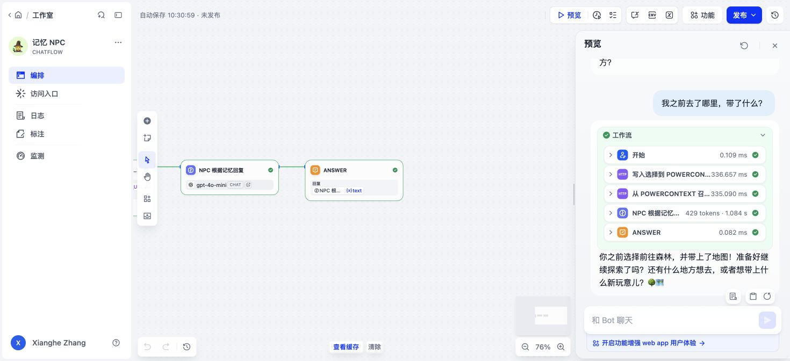

# Dify Cloud 记忆 NPC 验收

日期：2026-10-30（Asia/Shanghai）。实际运行于 Dify Cloud 的 Chatflow 预览，模型为 `gpt-4o-mini`。

应用：<https://cloud.dify.ai/app/5085afd2-a327-40d4-b60f-8ead163ad75a/workflow>。应用保留在所有者工作空间，未公开发布。

## 实际对话

1. 用户输入：`我选择前往森林并带上地图。`
   NPC 回答以“你决定前往森林，并带上地图。聪明的选择！”开始，两次 HTTP 调用、LLM 和 Answer 均成功。
2. 用户输入：`我之前去了哪里，带了什么？`
   NPC 实际回答：`你之前选择前往森林，并带上了地图！准备好继续探索了吗？还有什么地方想去，或者想带上什么新玩意儿？🌳🗺️`

## 记忆证据

- 本次 Scope：`scp_5zm4pd50hcvk7pdv3cbmtfp2k8`。运行前 `empty-scope.json` 显示 `status: empty`、`content: null`。
- 第一轮 Dify 写入节点返回 HTTP 200，创建 `mem_ent_c66bcde435494d7aa7d2527fdceb1c32`。原始节点输出在 `first-turn-http-output.json`。
- 第二轮 Dify 召回节点返回 HTTP 200，内容包含森林、地图以及上述第一轮的 entry ID。原始节点输出在 `second-turn-http-output.json`。
- LLM 内置会话记忆为 `null`；当前用户输入单独传入 USER 消息。第二轮问题没有包含森林或地图。
- `two-turn-page.md` 和 `second-turn-recall-page.md` 保存实际可见页面结构；`two-turn-workflow.jpg` 显示第二轮回答及成功节点。
- 运行使用带 Bearer 鉴权、限定本次 Scope 和两个路由的临时 HTTPS 网关。验收后网关与隧道均已关闭，PowerContext 服务保持运行，见 `connection-status.json`。

## 验证范围

本记录证明当前 Dify Cloud 已完成导入、真实记忆写入、后续召回及模型回答。此前的服务端重启验证不计作本次 Dify 页面运行；本次也没有验证长期公网部署或公开应用访问。
